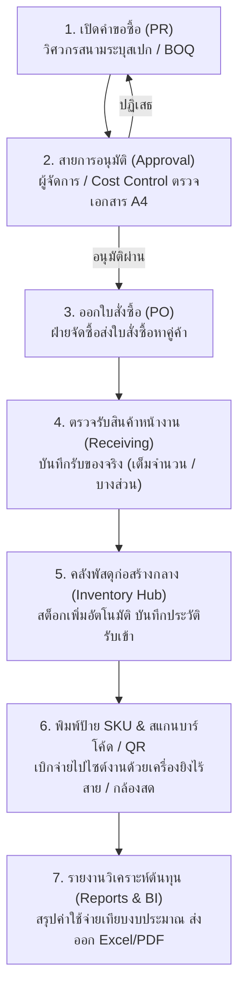

# ProcureSync Enterprise — ระบบบริหารงานจัดซื้อและคลังพัสดุก่อสร้างระดับองค์กร
### Enterprise Procurement & Central Construction Material Hub ERP

[](file:///c:/Users/jerks/Desktop/Procurement/src/pages/Manual.tsx)
[](file:///c:/Users/jerks/Desktop/Procurement/src/components/StandardManualDocument.tsx)
[](file:///c:/Users/jerks/Desktop/Procurement/src/App.tsx)
[](file:///c:/Users/jerks/Desktop/Procurement/src/components/StandardManualDocument.tsx)

> **คู่มือการใช้งานระบบฉบับสมบูรณ์ (Official User Manual & SOP Manual)**  
> รหัสเอกสารควบคุม: **SOP-PROC-2026-001 (Rev. 3.0)** | บังคับใช้: **13 ตุลาคม 2569**  
> ครอบคลุมวงจรจัดซื้อและบริหารคลังแบบครบวงจร 10 โมดูล: PR -> Approvals -> PO -> ตรวจรับ -> คลังกลาง & Master SKU บาร์โค้ด -> Data Import Hub -> Cloud Sync & LINE Notify -> รายงานผู้บริหาร

---

## 📌 สารบัญ (Table of Contents)

1. [ภาพรวมระบบและสถาปัตยกรรม (System Overview & Architecture)](#1-ภาพรวมระบบและสถาปัตยกรรม-system-overview--architecture)
2. [ผังกระบวนการทำงานทั้งวงจร (End-to-End Workflow Map)](#2-ผังกระบวนการทำงานทั้งวงจร-end-to-end-workflow-map)
3. [คู่มือการใช้งาน 10 โมดูลหลัก (Comprehensive Module User Guide)](#3-คู่มือการใช้งาน-10-โมดูลหลัก-comprehensive-module-user-guide)
   - [3.1 ระบบขอซื้อ (Purchase Requisitions - PR)](#31-ระบบขอซื้อ-purchase-requisitions---pr)
   - [3.2 การพิจารณาอนุมัติ (Multi-Level Approval Matrix)](#32-การพิจารณาอนุมัติ-multi-level-approval-matrix)
   - [3.3 ระบบสั่งซื้อ (Purchase Orders - PO) และการตรวจรับสินค้าหน้างาน](#33-ระบบสั่งซื้อ-purchase-orders---po-และการตรวจรับสินค้าหน้างาน)
   - [3.4 คลังพัสดุก่อสร้างกลาง (Hub) & ระบบบาร์โค้ด Master SKU](#34-คลังพัสดุก่อสร้างกลาง-hub--ระบบบาร์โค้ด-master-sku)
   - [3.5 ทะเบียนคู่ค้าและการประเมินผู้ขาย (Vendors & Evaluation)](#35-ทะเบียนคู่ค้าและการประเมินผู้ขาย-vendors--evaluation)
   - [3.6 ศูนย์นำเข้าข้อมูลอัจฉริยะ (Smart Data Import Hub - Excel, CSV & CAD)](#36-ศูนย์นำเข้าข้อมูลอัจฉริยะ-smart-data-import-hub---excel-csv--cad)
   - [3.7 การเชื่อมต่อคลาวด์และแจ้งเตือน (Cloud Sync, Integrations & LINE Alert)](#37-การเชื่อมต่อคลาวด์และแจ้งเตือน-cloud-sync-integrations--line-alert)
   - [3.8 รายงานและสถิติวิเคราะห์ต้นทุน (Reports & Executive BI Analytics)](#38-รายงานและสถิติวิเคราะห์ต้นทุน-reports--executive-bi-analytics)
   - [3.9 ผู้ใช้งานและสิทธิ์การเข้าถึง (Users & RBAC Enterprise Matrix 25 สิทธิ์)](#39-ผู้ใช้งานและสิทธิ์การเข้าถึง-users--rbac-enterprise-matrix-25-สิทธิ์)
   - [3.10 การตั้งค่าระบบ, ปรับสเกลหน้าจอ และ PWA (Settings & PWA)](#310-การตั้งค่าระบบ-ปรับสเกลหน้าจอ-และ-pwa-settings--pwa)
4. [คู่มือการใช้งานฮาร์ดแวร์บาร์โค้ดและเครื่องพิมพ์สติกเกอร์ (Hardware & Printing Guide)](#4-คู่มือการใช้งานฮาร์ดแวร์บาร์โค้ดและเครื่องพิมพ์สติกเกอร์-hardware--printing-guide)
5. [คำถามที่พบบ่อยและการแก้ปัญหา (FAQ & Troubleshooting)](#5-คำถามที่พบบ่อยและการแก้ปัญหา-faq--troubleshooting)
6. [การติดตั้งและพัฒนาสำหรับโปรแกรมเมอร์ (Tech Stack & Setup)](#6-การติดตั้งและพัฒนาสำหรับโปรแกรมเมอร์-tech-stack--setup)

---

## 1. ภาพรวมระบบและสถาปัตยกรรม (System Overview & Architecture)

**ProcureSync** เป็นระบบบริหารงานจัดซื้อและคลังพัสดุอุปกรณ์ก่อสร้างกลาง (Enterprise Procurement ERP & Central Material Hub) พัฒนาขึ้นเพื่อแก้ปัญหาการทำงานซ้ำซ้อน งบประมาณบานปลาย และพัสดุสูญหายในอุตสาหกรรมรับเหมาก่อสร้างและวิศวกรรม

### จุดเด่นสำคัญ (Key Highlights)
- **Zero Double-Data Entry**: ข้อมูลจากใบขอซื้อ (PR) จะไหลไปออกใบสั่งซื้อ (PO), เข้าคลังสินค้า, และลงบัญชีคุมงบประมาณโดยอัตโนมัติ ไม่ต้องกรอกซ้ำ
- **BOQ Cost Control**: ตรวจสอบงบประมาณคงเหลือและ Cost Code ทุกครั้งที่มีการขอซื้อ
- **Master SKU Barcode (1D Code 128) & QR Code**: สแกนเบิกจ่ายและรับเข้าใน 3 วินาที รองรับทั้งเครื่องยิงบาร์โค้ดไร้สายและกล้องสมาร์ตโฟน
- **Smart Data Import Hub**: นำเข้าข้อมูลชุดใหญ่จาก Excel (.xlsx, .xls), CSV, JSON และแบบจำลอง CAD/DXF พร้อมระบบ Auto Column Mapping
- **Cloud & LINE Connectivity**: ซิงก์ข้อมูลสองทางกับ Google Sheets และแจ้งเตือนผู้อนุมัติผ่าน LINE Notify ทันที
- **Enterprise RBAC 25 Granular Permissions**: กำหนดสิทธิ์แบบเจาะลึก 25 สิทธิ์ย่อยแยกตาม 9 โมดูลงาน
- **Responsive & PWA Offline**: ใช้งานได้เสมือนแอปเนทีฟบนมือถือ โน้ตบุ๊ก และแท็บเล็ต พร้อมระบบปรับสเกลหน้าจอ (Display Density 80%-110%)

---

## 2. ผังกระบวนการทำงานทั้งวงจร (End-to-End Workflow Map)



---

## 3. คู่มือการใช้งาน 10 โมดูลหลัก (Comprehensive Module User Guide)

### 3.1 ระบบขอซื้อ (Purchase Requisitions - PR)
- **ผู้รับผิดชอบหลัก**: วิศวกรสนาม (Site Engineer) / ผู้จัดการโครงการ (PM) / เจ้าหน้าที่จัดซื้อ
- **เส้นทาง**: `/pr`
- **ขั้นตอนการปฏิบัติงาน**:
  1. กดปุ่ม `+ สร้างใบขอซื้อใหม่ (Create PR)` ที่มุมขวาบน
  2. เลือกรหัสโครงการ (Project Code), วันที่ต้องการใช้ของ, และความเร่งด่วน (ปกติ / ด่วน / ด่วนที่สุด)
  3. สามารถกดปุ่ม `เลือกจากเทมเพลตมาตรฐาน (BOQ Templates)` เพื่อดึงชุดรายการพัสดุก่อสร้างมาตรฐาน เช่น งานฐานราก, งานโครงสร้างเหล็ก, งานระบบไฟฟ้า
  4. ระบุปริมาณ ราคาต่อหน่วย และตรวจสอบยอดงบประมาณ BOQ คงเหลือ
  5. กด `ดูเอกสารมาตรฐาน A4` เพื่อตรวจทานรูปแบบทางการ (FM-PUR-001) และกด `ส่งเพื่อขออนุมัติ (Submit)`

### 3.2 การพิจารณาอนุมัติ (Multi-Level Approval Matrix)
- **ผู้รับผิดชอบหลัก**: วิศวกรโครงการ (PM) / ฝ่ายควบคุมงบประมาณ (Cost Control) / ผู้บริหาร (Director/MD)
- **เส้นทาง**: `/approvals`
- **ตารางกรอบวงเงินอนุมัติ (Approval Thresholds)**:
  - **ระดับ 1 (Level 1)**: วงเงินไม่เกิน **50,000 บาท** (ผู้จัดการโครงการหน้างานอนุมัติ)
  - **ระดับ 2 (Level 2)**: วงเงิน **50,001 - 500,000 บาท** (ฝ่ายควบคุมต้นทุน Cost Control อนุมัติ)
  - **ระดับ 3 (Level 3)**: วงเงิน **มากกว่า 500,000 บาท** (ผู้อำนวยการ / ผู้บริหารระดับสูงอนุมัติ)
- **เครื่องมือตรวจทาน**:
  - กด `ดูเอกสารมาตรฐาน →` เพื่อเปิดเอกสาร A4
  - มีปุ่ม `ย่อพอดีหน้าจอ / ซูม 100%` เพื่อตรวจทานบนมือถือหรือจอโน้ตบุ๊กได้อย่างสะดวก
  - กด `อนุมัติคำขอ (Approve)` เพื่อลงนามดิจิทัล หรือกด `ปฏิเสธคำขอ (Reject)` พร้อมระบุหมายเหตุส่งกลับ

### 3.3 ระบบสั่งซื้อ (Purchase Orders - PO) และการตรวจรับสินค้าหน้างาน
- **ผู้รับผิดชอบหลัก**: เจ้าหน้าที่จัดซื้อ (Buyer) / เจ้าหน้าที่สโตร์หน้างาน
- **เส้นทาง**: `/po`
- **ขั้นตอนการออก PO**:
  1. กดปุ่ม `สร้าง PO จาก PR ที่อนุมัติแล้ว` เพื่อดึงข้อมูล PR ที่ผ่านการอนุมัติแล้วมาสร้าง PO โดยไม่ต้องกรอกซ้ำ
  2. เลือกคู่ค้า (Vendor), เงื่อนไขการชำระเงิน (เช่น เครดิต 30 วัน), และสถานที่ส่งมอบ
  3. กดส่งเอกสารให้ผู้ขาย และสั่งพิมพ์เอกสารทางการ A4 พร้อมตราสัญลักษณ์บริษัท
- **ขั้นตอนการตรวจรับสินค้า (Goods Receiving)**:
  - เมื่อสินค้ามาส่ง กดปุ่ม `ตรวจรับสินค้า (Receive Goods)` ในรายการ PO นั้น
  - **กรณีส่งครบ**: กรอกยอดครบ 100% สถานะจะเปลี่ยนเป็น `Completed` และสต็อกจะเพิ่มทันที
  - **กรณีส่งบางส่วน**: กรอกเฉพาะจำนวนที่ส่งจริง สถานะจะเปลี่ยนเป็น `Partially Received` ระบบจะเก็บยอดค้างส่งไว้รอรับในงวดถัดไป

### 3.4 คลังพัสดุก่อสร้างกลาง (Hub) & ระบบบาร์โค้ด Master SKU
- **ผู้รับผิดชอบหลัก**: เจ้าหน้าที่สโตร์ / ผู้จัดการคลังพัสดุ / โฟร์แมน
- **เส้นทาง**: `/inventory`
- **ความสามารถสำคัญ**:
  - **Master SKU Barcode (1D Code 128) & QR Code**: สินค้าทุกรายการมีรหัส SKU และบาร์โค้ดมาตรฐาน
  - **เครื่องยิงบาร์โค้ดไร้สาย (Wireless Barcode Gun)**: เสียบหัวรับ USB เข้าเครื่องคอมพิวเตอร์ แล้วยิงบาร์โค้ดบนกล่องพัสดุ ระบบจะค้นหาสินค้าทันที
  - **กล้องสแกนสด (Live Camera)**: เปิดกล้องสมาร์ตโฟนส่องป้าย พร้อมปุ่มสลับกล้องหน้า/หลัง และปุ่มเปิดไฟฉายในที่มืด
  - **การพิมพ์ป้ายสติกเกอร์ความร้อน**: รองรับขนาดสติกเกอร์ 50x30 มม., 75x50 มม., Shelf Tag ติดชั้นวาง และชุดพิมพ์แผ่น A4 ตามจำนวนสต็อกจริง
  - **ตรวจนับสต็อก (Physical Count)**: บันทึกยอดนับจริง คำนวณผลต่าง (+ / -) อัตโนมัติ

### 3.5 ทะเบียนคู่ค้าและการประเมินผู้ขาย (Vendors & Evaluation)
- **ผู้รับผิดชอบหลัก**: เจ้าหน้าที่จัดซื้อ / ผู้จัดการฝ่ายจัดซื้อ
- **เส้นทาง**: `/vendors`
- **ขั้นตอนการปฏิบัติงาน**:
  - กด `+ เพิ่มคู่ค้าใหม่` บันทึกชื่อบริษัท เลขผู้เสียภาษี เงื่อนไขเครดิตเทอม และหมวดหมู่วัสดุ
  - มีประวัติการสั่งซื้อย้อนหลังรวมจากทุก PO
  - ระบบประเมินคู่ค้า (Vendor Rating A/B/C) พิจารณาจากคุณภาพสินค้า ความตรงต่อเวลา และการบริการ

### 3.6 ศูนย์นำเข้าข้อมูลอัจฉริยะ (Smart Data Import Hub - Excel, CSV & CAD)
- **ผู้รับผิดชอบหลัก**: เจ้าหน้าที่จัดซื้อ / สโตร์ / วิศวกรถอดแบบ BOQ
- **เส้นทาง**: `/import`
- **ขั้นตอนการนำเข้า 3 ขั้นตอน**:
  1. **ดาวน์โหลดเทมเพลต & อัปโหลดไฟล์**: กด `ดาวน์โหลดเทมเพลตตัวอย่าง` ไปกรอก หรือลากวางไฟล์ Excel (.xlsx, .xls), CSV, JSON, DXF/CAD เข้าสู่ระบบ
  2. **จับคู่คอลัมน์อัตโนมัติ (AI Column Mapping)**: ระบบจะวิเคราะห์ชื่อหัวตารางและแมปเข้ากับฟิลด์ของระบบให้อัตโนมัติ สามารถปรับเปลี่ยนเองได้
  3. **เลือกโหมดผสานข้อมูล & บันทึก**:
     - `Merge (Upsert)`: อัปเดตข้อมูลเดิมและเพิ่มข้อมูลใหม่ (แนะนำ)
     - `Append`: เพิ่มต่อท้ายข้อมูลเดิมทั้งหมด
     - `Overwrite`: ลบข้อมูลเดิมแล้วแทนที่ใหม่ทั้งหมด
  - **Import History**: มีแท็บประวัติตรวจสอบย้อนหลัง วันที่ ผู้ดำเนินการ และจำนวนแถวที่สำเร็จ

### 3.7 การเชื่อมต่อคลาวด์และแจ้งเตือน (Cloud Sync, Integrations & LINE Alert)
- **ผู้รับผิดชอบหลัก**: ผู้ดูแลระบบ (Admin) / เจ้าหน้าที่ไอที
- **เส้นทาง**: `/integrations`
- **ฟังก์ชันการเชื่อมต่อ**:
  - **Google Sheets Two-Way Live Sync**: คัดลอกเทมเพลต Google Apps Script ไปติดตั้งใน Extensions ของ Google Sheets เพื่อเชื่อมโยงการซิงก์ข้อมูลสองทาง
  - **LINE Notify / LINE Alert**: ใส่ Access Token และชื่อกลุ่มไลน์ ระบบจะส่งข้อความแจ้งเตือนพร้อมลิงก์ตรวจเอกสารเข้ากลุ่มแชทไลน์โครงการทันทีที่มีคำขออนุมัติ
  - **Cloud Backup**: ส่งออก Full Data JSON Snapshot และสร้างลิงก์จัดเก็บบน Google Drive / Dropbox
  - **MVP Demo Presentation Sandbox**: สลับโหมดจำลองสถานการณ์เพื่อสาธิตระบบแก่ผู้บริหาร

### 3.8 รายงานและสถิติวิเคราะห์ต้นทุน (Reports & Executive BI Analytics)
- **ผู้รับผิดชอบหลัก**: ผู้บริหาร / ผู้จัดการโครงการ / ผู้จัดการฝ่ายบัญชี-การเงิน
- **เส้นทาง**: `/reports`
- **รายงานหลัก**:
  - สรุปยอดการใช้จ่ายสะสม (Total Spend & Monthly Spend Trend)
  - วิเคราะห์หมวดหมู่การใช้วัสดุ (Spend by Material Category)
  - สถิติประสิทธิภาพคู่ค้า (Vendor Performance & On-time Delivery Rate)
  - ส่งออกรายงานเป็นไฟล์ **Microsoft Excel (.csv)** และ **พิมพ์รายงาน / บันทึก PDF**

### 3.9 ผู้ใช้งานและสิทธิ์การเข้าถึง (Users & RBAC Enterprise Matrix 25 สิทธิ์)
- **ผู้รับผิดชอบหลัก**: ผู้ดูแลระบบสูงสุด (System Administrator)
- **เส้นทาง**: `/users`
- **ตารางสิทธิ์ Granular 25 สิทธิ์แยกตาม 9 โมดูล**:
  - ควบคุมปุ่มสร้าง แก้ไข ลบ อนุมัติ และดูข้อมูลอย่างอิสระ
  - **Persona Switcher**: เมนูด้านบนสำหรับสลับบทบาทจำลอง เพื่อตรวจสอบมุมมองของพนักงานแต่ละตำแหน่ง
  - **Admin Self-Protection**: ล็อกไม่ให้ลบตนเองหรือปิดสิทธิ์แอดมิน เพื่อความปลอดภัยสูงสุดของระบบ

### 3.10 การตั้งค่าระบบ, ปรับสเกลหน้าจอ และ PWA (Settings & PWA)
- **ผู้รับผิดชอบหลัก**: ผู้ใช้งานทุกคน
- **เส้นทาง**: `/settings`
- **การปรับแต่ง**:
  - **Display Density Scaling**: ปรับขนาดสเกล UI ทั้งระบบเป็น **80% (กะทัดรัดสมดุล เหมาะกับจอโน้ตบุ๊ก)**, 90%, 100% (มาตรฐาน), หรือ 110%
  - **Language Toggle**: สลับภาษาไทย 🇹🇭 / English 🇬🇧 ได้ทันที
  - **PWA Installation**: กดติดตั้งแอปบนหน้าจอหลักสมาร์ตโฟนหรือเดสก์ท็อป เปิดใช้งานได้เต็มจอและเร็วขึ้น
  - **Offline Indicator**: แจ้งเตือนเมื่อเน็ตหลุด พร้อมเปิดดูข้อมูลแคชในเครื่องได้ต่อเนื่อง

---

## 4. คู่มือการใช้งานฮาร์ดแวร์บาร์โค้ดและเครื่องพิมพ์สติกเกอร์ (Hardware & Printing Guide)

### ก. การใช้เครื่องยิงบาร์โค้ดไร้สาย (Wireless Barcode Gun)
1. เสียบตัวรับสัญญาณ Wireless USB Dongle เข้ากับเครื่องคอมพิวเตอร์หรือแล็ปท็อป
2. ในหน้าคลังสินค้า ให้คลิกที่ช่องค้นหา หรือเปิดหน้าต่างสแกนเนอร์
3. ยิงเลเซอร์ไปที่บาร์โค้ดบนตัวพัสดุ ระบบจะอ่านรหัส Master SKU และดึงข้อมูลสินค้าพร้อมยอดสต็อกขึ้นมาทันที

### ข. การพิมพ์ป้ายสติกเกอร์ความร้อน (Direct Thermal Label Printing)
- รองรับเครื่องพิมพ์ความร้อนความเร็วสูง เช่น **Xprinter, Zebra, TSC, Gprinter**
- ขนาดป้ายมาตรฐานที่รองรับ:
  - **50 x 30 mm**: ขนาดกะทัดรัดสำหรับแปะกล่องพัสดุและวัสดุชิ้นเล็ก
  - **75 x 50 mm**: ขนาดมาตรฐานคลังสินค้า แสดงชื่อ สเปก โครงการ และบาร์โค้ดชัดเจน
  - **Shelf Tag (ป้ายติดชั้นวาง)**: สำหรับติดระบุตำแหน่งบนชั้นเก็บพัสดุในสโตร์
  - **A4 Sheet Label**: พิมพ์หลายดวงลงบนกระดาษสติกเกอร์ A4 สำหรับเครื่องพิมพ์สำนักงานทั่วไป

---

## 5. คำถามที่พบบ่อยและการแก้ปัญหา (FAQ & Troubleshooting)

| ลำดับ | ปัญหาที่พบ | วิธีการแก้ไข |
|---|---|---|
| 1 | สแกน QR / บาร์โค้ดแล้วกล้องไม่เปิด | คลิกไอคอนแม่กุญแจหน้า URL ในเบราว์เซอร์ แล้วเลือก **อนุญาตการเข้าถึงกล้อง (Allow Camera)** หรือใช้เครื่องยิงบาร์โค้ดไร้สายยิงแทน |
| 2 | PR อนุมัติแล้ว ทำไมยังไม่มีของมาส่ง? | ฝ่ายจัดซื้อต้องไปที่หน้า **PO** แล้วกด **"สร้าง PO จาก PR ที่อนุมัติแล้ว"** เพื่อส่งคำสั่งซื้อไปยังคู่ค้าก่อน |
| 3 | สินค้ามาส่งไม่ครบตามยอดใน PO | กด **"ตรวจรับสินค้า"** แล้วกรอกเฉพาะจำนวนที่รับจริงในงวดนั้น ระบบจะปรับสถานะเป็น `Partially Received` และจำยอดค้างส่งไว้รอรับต่องวดถัดไป |
| 4 | ต้องการติดตั้งลงหน้าจอมือถือโดยไม่โหลดสโตร์ | เปิดบน Safari (iOS) หรือ Chrome (Android) แล้วกด **"เพิ่มไปยังหน้าจอโฮม (Add to Home Screen)"** หรือกดปุ่ม **"ติดตั้งแอป ProcureSync"** ในแถบเมนู |
| 5 | นำเข้า Excel แล้วหัวตารางไม่ตรง | ในหน้า Data Import Hub ใช้ระบบ **"Auto-Map Columns"** เพื่อจับคู่ฟิลด์ หรือกด **"ดาวน์โหลดเทมเพลตมาตรฐาน"** ไปกรอกก่อนอัปโหลด |
| 6 | หน้าจอตัวหนังสือใหญ่หรือเล็กเกินไป | ไปที่หน้า **ตั้งค่า (Settings)** เลือก **Display Density** เป็น `80%` สำหรับจอโน้ตบุ๊ก หรือ `100%` สำหรับจอใหญ่ |
| 7 | การตั้งค่าแจ้งเตือนเข้ากลุ่ม LINE | นำ Token จาก notify-bot.line.me มาวางในการ์ด LINE Notify ในหน้า **Integrations** แล้วกด **"ทดสอบส่งข้อความ"** |

---

## 6. การติดตั้งและพัฒนาสำหรับโปรแกรมเมอร์ (Tech Stack & Setup)

### เทคโนโลยีที่ใช้ (Tech Stack)
- **Frontend Core**: React 19, TypeScript, Vite 6
- **Styling**: Tailwind CSS (พร้อม Calibrated Density Scales)
- **State Management**: React Context (`ProcurementContext`, `AuthContext`, `LanguageContext`, `NotificationContext`)
- **Database & Cloud**: Firebase Firestore & Auth, Local Storage Offline Cache
- **Barcodes & PDFs**: JSBarcode (1D Code 128), HTML5-QRCode, QRCode, jsPDF, html2canvas
- **Data Visualization**: Recharts BI Engine
- **File Parsing**: SheetJS (XLSX), CSV Parser, CAD/DXF Parser

### คำสั่งเริ่มต้นใช้งาน (Getting Started)

```bash
# 1. ติดตั้ง Dependencies
npm install

# 2. เริ่มต้นรันเซิร์ฟเวอร์สำหรับการพัฒนา (Development Server)
npm run dev
# เปิดเบราว์เซอร์ที่ http://localhost:3000

# 3. ตรวจสอบ Type Checking
npm run lint

# 4. คอมไพล์โปรดักชันบิลด์ (Production Build)
npm run build
```

---

**© 2026 บริษัท พรอคเคียวซิงค์ คอนสตรัคชั่น แอนด์ เอ็นจิเนียริ่ง จำกัด (PROCURESYNC CO., LTD.)**  
*เอกสารนี้เป็นคู่มือมาตรฐานการปฏิบัติงานภายใน (Internal Controlled SOP Manual)*
